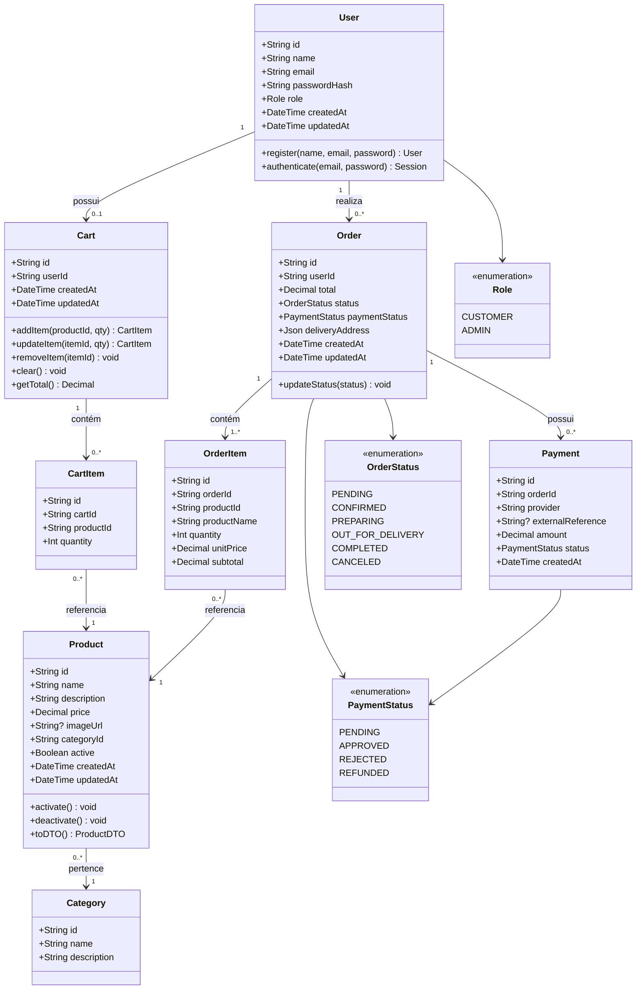
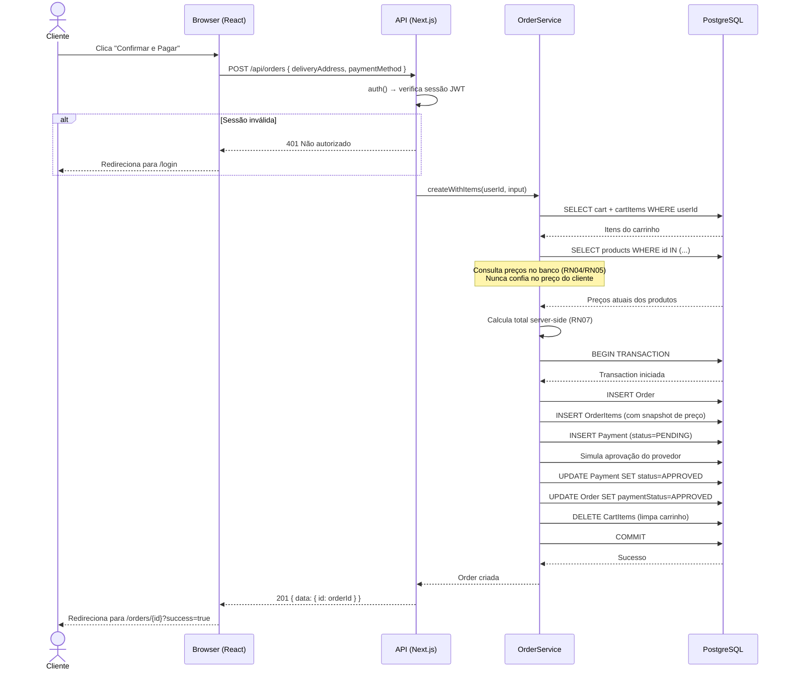
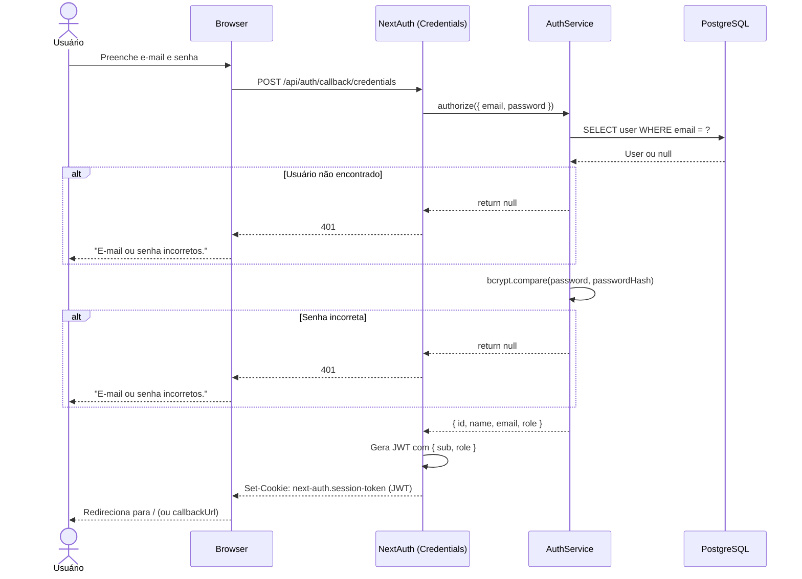
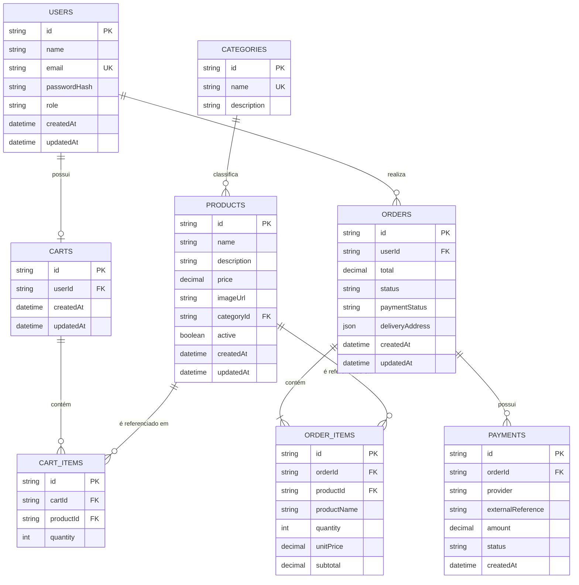

# Diagramas — Cupcake Gourmet
**Projeto Integrador Transdisciplinar em Engenharia de Software II**
**Aluno:** Murilo Bandeira Gruppi — RGM 34169679

---

## 1. Diagrama de Casos de Uso

```mermaid
graph TD
  Actor_Cliente([👤 Cliente])
  Actor_Admin([👤 Administrador])
  Actor_Sistema([⚙️ Sistema])

  subgraph UC_Auth["Autenticação"]
    UC01["UC01 — Cadastrar conta"]
    UC02["UC02 — Fazer login"]
    UC03["UC03 — Encerrar sessão"]
  end

  subgraph UC_Catalogo["Catálogo"]
    UC04["UC04 — Visualizar catálogo"]
    UC05["UC05 — Buscar produtos"]
    UC06["UC06 — Filtrar por categoria"]
    UC07["UC07 — Ver detalhe do produto"]
  end

  subgraph UC_Carrinho["Carrinho"]
    UC08["UC08 — Adicionar produto ao carrinho"]
    UC09["UC09 — Alterar quantidade"]
    UC10["UC10 — Remover produto"]
    UC11["UC11 — Visualizar carrinho"]
  end

  subgraph UC_Compra["Compra"]
    UC12["UC12 — Preencher endereço de entrega"]
    UC13["UC13 — Selecionar forma de pagamento"]
    UC14["UC14 — Confirmar pedido"]
    UC15["UC15 — Consultar meus pedidos"]
    UC16["UC16 — Ver detalhe do pedido"]
  end

  subgraph UC_Admin["Administração"]
    UC17["UC17 — Ver dashboard"]
    UC18["UC18 — Listar produtos"]
    UC19["UC19 — Criar produto"]
    UC20["UC20 — Editar produto"]
    UC21["UC21 — Desativar produto"]
    UC22["UC22 — Listar pedidos"]
    UC23["UC23 — Ver detalhe do pedido"]
    UC24["UC24 — Atualizar status do pedido"]
  end

  Actor_Cliente --> UC01
  Actor_Cliente --> UC02
  Actor_Cliente --> UC03
  Actor_Cliente --> UC04
  Actor_Cliente --> UC05
  Actor_Cliente --> UC06
  Actor_Cliente --> UC07
  Actor_Cliente --> UC08
  Actor_Cliente --> UC09
  Actor_Cliente --> UC10
  Actor_Cliente --> UC11
  Actor_Cliente --> UC12
  Actor_Cliente --> UC13
  Actor_Cliente --> UC14
  Actor_Cliente --> UC15
  Actor_Cliente --> UC16

  Actor_Admin --> UC02
  Actor_Admin --> UC03
  Actor_Admin --> UC17
  Actor_Admin --> UC18
  Actor_Admin --> UC19
  Actor_Admin --> UC20
  Actor_Admin --> UC21
  Actor_Admin --> UC22
  Actor_Admin --> UC23
  Actor_Admin --> UC24

  UC14 --> UC15
  UC08 -.->|"<<include>>"| UC02
```



---

## 2. Diagrama de Classes



---

## 3. Diagrama de Sequência — Fluxo de Compra



---

## 4. Diagrama de Sequência — Autenticação



---

## 5. Diagrama de Atividades — Finalização de Pedido

```mermaid
flowchart TD
  A([Início]) --> B[Cliente acessa /checkout]
  B --> C{Está autenticado?}
  C -- Não --> D[Redireciona para /login]
  D --> E[Faz login] --> B
  C -- Sim --> F{Carrinho tem itens?}
  F -- Não --> G[Redireciona para /products]
  F -- Sim --> H[Exibe formulário de checkout]
  H --> I[Preenche endereço e forma de pagamento]
  I --> J[Clica em Confirmar e Pagar]
  J --> K[Validação client-side do formulário]
  K --> L{Dados válidos?}
  L -- Não --> M[Exibe erros nos campos] --> I
  L -- Sim --> N[POST /api/orders]
  N --> O[Verifica sessão no servidor]
  O --> P[Consulta carrinho no banco]
  P --> Q{Carrinho não-vazio?}
  Q -- Não --> R[Retorna 400 Bad Request] --> S[Exibe mensagem de erro]
  Q -- Sim --> T[Consulta preços no banco]
  T --> U[Calcula total server-side]
  U --> V[Inicia transação no banco]
  V --> W[Cria Order + OrderItems]
  W --> X[Processa pagamento via provider]
  X --> Y{Pagamento aprovado?}
  Y -- Não --> Z[Atualiza paymentStatus=REJECTED]
  Z --> AA[ROLLBACK / mantém pedido como REJECTED]
  Y -- Sim --> AB[Atualiza paymentStatus=APPROVED]
  AB --> AC[Limpa carrinho]
  AC --> AD[COMMIT]
  AD --> AE[Retorna 201 com orderId]
  AE --> AF[Redireciona para /orders/{id}?success=true]
  AF --> AG([Fim])
```

---

## 6. Modelo Entidade-Relacionamento (MER)


